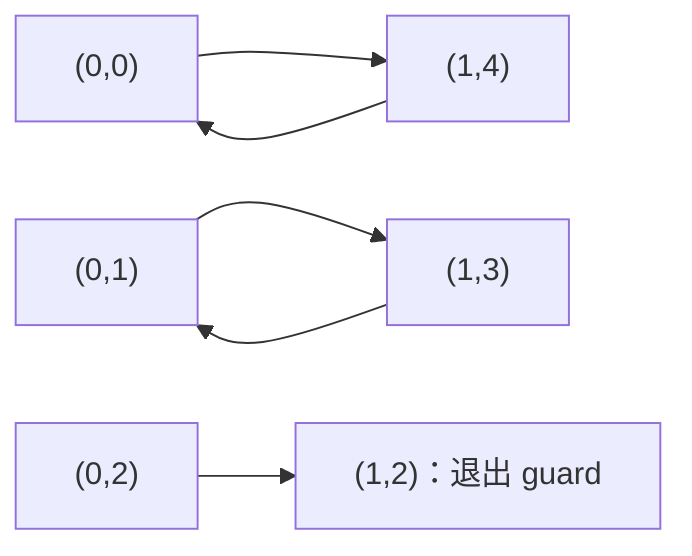

# 固定种子上的 CondTerm RSG 协调泛化实验

**结论：PARTIAL。** 在真实官方 RSG 接口上，固定两个析取项、原始谓词及候选语言后，单遍、换序、迭代不动点均停留在 R0；受控单项穷举也找不到严格扩展。`Joint-2-Selector` 自动枚举四个候选后得到 R*，全整数 SMT 证明其正确。但简单有限区域闭包修复也能达到 R*，而且在本例更快。正常 CondTerm 能求出精确终止条件，oracle 只展示少一次外层迭代的潜力，尚无实际联合实现的端到端加速证据。

正式数据来自服务器 `/root/RSG` 的首批运行。结果总表为 [results.json](../results/results.json)，源码定位为 [source_audit.md](source_audit.md)，完整复现步骤为 [reproducibility.md](reproducibility.md)。脚本在独立目录完整重跑通过，重跑数据单独保存，不混入下面的 30 次统计。

## 1. 官方实现是否成功下载、构建和执行？

是。下载的是官方 Zenodo record **16891885 / v1**，发布日期 2025-08-18，来自父 DOI 16891884。338,912,600 字节的 RAR 通过元数据 MD5、SHA-256 和解压 CRC 校验。包内 Git HEAD 为 `05e6dfac376141e14bb8420f56c4f2c12eccba3f`，但包内工作树并非 clean，因此用整个 Artifact 哈希固定版本。

Ubuntu 22.04.5、Mono 6.8、C5.0、Z3 4.8.9 下构建成功。为兼容 Mono 编译器使用 `LangVersion=Experimental`，没有修改官方算法；Z3 使用同版本官方 Python wheel 内 CLI，发行包装与 README 中 Ubuntu zip 不同。未经插桩的官方 WhileTrue 示例返回 `1 verified, 0 errors`、退出码 0，外部耗时 0.314524111 秒。网络下载与初次构建失败均保留日志。

## 2. RSG 在哪里实现，与论文一致吗？

真正调用的是 `Boogie/Source/Houdini/MLHoudini.cs` 中 `LearnInv` 第 1603 行的 `modifiedGeneralizeRS_2`，不是同文件的旧版本函数。其第 1617 行开始的活跃实现对应 Algorithm 2：每个析取项先做 predicate elimination，再做常量 digging，然后更新完整 R。每次 VC 包括当前项和其他项，不是孤立验证一个项。

遍历只有一遍，不回访，不合并 DNF，不引入新混合属性。digging 一次可以删除多个区间假设，不能简化为逐个移动边界。实际距离集为 `{0,1,2,4,6,8,10,20,50}`，使用 Z3 最小化 UNSAT core。实现将最远尾区间设为硬约束，并用 `newSimplifyGenIntervals` 恢复单个上界；这些表示细节比论文的通用区间合取描述更受限。具体行号、调用链和异常分支见源码审计。

## 3. 是否真正注入了固定 R0？语义验证是否充分？

是。[RSGExperiment.cs](../experiments/RSGExperiment.cs) 在官方 parser、循环插桩和 VC 构造完成后跳过 RSLearn，直接调用上述未修改方法。日志明确给出入口名和实际 AST。完整逻辑补丁与方法哈希均已保存。

冻结输入为：

```text
R0 = (p <= 0 && -p <= 0 && x <= 0 && -x <= 0)
  || (p <= 1 && -p <= -1 && x <= 4 && -x <= -4)
```

它等价于 `(p=0 ∧ x=0) ∨ (p=1 ∧ x=4)`。目标为：

```text
R* = (p=0 ∧ 0<=x<=1) ∨ (p=1 ∧ 3<=x<=4)
G  = (p=0 ∧ 0<=x<=2) ∨ (p=1 ∧ 3<=x<=4)
T  = (p'=1-p) ∧ (x'=4-x)
```

Boogie 使用数学整数和 `havoc p,x`；C trace 模板使用任意 `int` 输入。独立检查器从实际 C/BPL 文件提取 guard 和顺序赋值，对原始文件及两种官方模板共六份模型验证等价。数学证明覆盖全整数域，不依赖 C trace 的有限采样；C 的可表示入口是 int32，不能称为运行时枚举了所有数学整数。guard 为真时 `p∈{0,1}, x∈[0,4]`，两条赋值无 int32 溢出，SMT 已证明。形式化转移只用于循环 guard 为真的状态。

[独立验证](../results/independent_smt.json) 的关键结果：

| 查询 | 结果 | 含义 |
|---|---|---|
| R0 非空 | SAT | 任意入口允许直接到达其循环状态 |
| R0 ∧ ¬G | UNSAT | 种子位于循环条件内 |
| R0 ∧ T ∧ ¬R0' | UNSAT | 种子闭合 |
| R0 ∧ ¬R* | UNSAT | 包含种子 |
| R* ∧ ¬G；R* ∧ T ∧ ¬R*' | 均 UNSAT | 联合结果是 recurrent set |
| R* ∧ ¬R0 | SAT | 扩展严格，新增状态另有完整证明 |
| A ∧ T ∧ ¬A' | SAT | `(0,1)→(1,3)` 破坏只放宽第一项的闭包 |
| B ∧ T ∧ ¬B' | SAT | `(1,3)→(0,1)` 破坏只放宽第二项的闭包 |

拒绝四类负面候选：整个 G（包含坏状态 `(0,2)`）、丢失种子、破坏闭包、包含 guard 外状态。每个查询有 SMT-LIB、SAT/UNSAT、见证或反例及耗时；无 UNKNOWN。

精确非终止集合也是 R*：`G\R*` 精确等于 `{(0,2)}`，它一步到 `(1,2)` 后退出；G 外入口零次执行循环；R* 闭合且转移两步回到原点。因此精确终止条件是 `¬R*`。



## 4. 官方逐项 RSG 返回什么？

A1 的真实完整输出（只调整排版）为：

```text
(x <= 0 && -p <= 0 && -x <= 0 && p <= 0)
|| (-x <= -4 && x <= 4 && -p <= -1 && p <= 1)
```

独立 SMT 证明它与 R0 等价，并证明没有严格增加状态。算法执行了每项一次谓词删除和一次 digging，共 **4 次 SMT、4 次 core**；没有自行省略官方步骤。实际传入/返回的 SMT 表达式、属性表、命令与输出见 [interface.json](../results/interface.json) 及附录。

| 配置 | 实际配置 / 搜索范围 | 结果 | 全整数独立验证 |
|---|---|---|---|
| A1 | unary，原顺序，一次官方 RSG | R0 | 有效、无严格扩展 |
| A2 | unary，交换两项，一次官方 RSG | R0 | 有效、无严格扩展 |
| A3 | unary，反复完整调用，安全上限 10 | 第一次后已与输入等价 | 有效、到达语义不动点 |
| A4 精确边界 | 每次只改一项，20,000 个边界/删除组合 | 0 个有效严格扩展 | 下述穷举证据 |
| A4 强化 unary | 包含非连续 unary 集合的 64 个投影组合 | 0 个有效严格扩展 | 256 次全整数 SMT |
| A5 | 默认属性表，冻结同一 R0 AST | R0 | 有效、无严格扩展 |
| Joint-2-Selector | 四个完整布尔赋值 | R* | 有效、严格扩展、等于目标 |
| Closure-Repair | 精确 guard 区域枚举，迭代删除出界状态 | R* | 有效、严格扩展、等于目标 |

## 5. 换序、重复和更强单项搜索改变结论吗？

都没有。A3 在首次调用后用 `Xor(previous,current)` 得到 UNSAT，因此立即达到语义不动点；不是仅因达到安全上限而停止。

A4 是独立受控搜索，**不是官方算法**。精确版本为两个项各自四个有符号边界提供 9 个官方距离及“删除谓词”共 10 个选择，共 `2×10^4=20,000` 个组合。对包含原种子的笛卡尔矩形，任何相位边界放宽都包含已证实的 guard 外见证；x 越过 guard 也同样可精确剔除。用 8 个全整数 SMT 证书支持该剪枝，19,995 个组合被 guard 排除，余下 5 个逐项验证；共 33 次 SMT，严格有效扩展为零。所有 20,000 行枚举记录保留，剪枝不是随机抽样。

强化版本进一步覆盖带孔 unary 谓词：每个项仍为 `P×X`，包含对应种子且位于 G 内，故 `P⊆{0,1}`、`X⊆{0,1,2,3,4}`。固定种子坐标后，每项最多 `2×16=32` 个投影组合，两项共 64 个；每个组合验证 guard、闭包、种子包含和严格性。这是对比官方 unary 输出语言更强的集合语言，而非限制在距离表上的猜测。

因此在**冻结两项、单项单调放宽、unary 属性**的范围内，任何合法第一步都不能产生严格扩展。这是语言与协调条件共同造成的局部阻碍，不只是一次 core 的选择或遍历顺序问题。该论证不覆盖任意 DNF 重构、新混合谓词、多项同时修改或非单调搜索。

## 6. 默认混合谓词能否避开受限见证？

A5 实际 learner 属性表为 `p;x;p+x;p-x`，A1 为 `p;x`，正负方向由冻结不等式表达。A5 保留默认表，但在同一个冻结 unary R0 上仍返回 R0。原因是活跃 RSG 泛化输入中已有的原子谓词，不从属性表重新学习一个表示。因此不能把 A5 的结果扩大解释为“默认 CondTerm 永远不能处理这个循环”。

不冻结种子时，独立 RSLearn 调用确实直接学到了 R*，含混合属性。完整默认数据共享流程则先学到语义等于 R0 的混合 DNF，详见第 9 节。种子与语法表示、采样/数据共享流程相关，必须分别报告。

## 7. 联合搜索是否自动找到 R*？

是。候选只来自预先指定的两个一单位放宽：第一项 x 上界 `0→1`，第二项 x 下界 `4→3`。每次将两个布尔选择全部固定后，再做三个全整数 SMT 查询（包含种子、guard、闭包），遍历全部四种赋值：

| s1,s2 | 集合 | 包含 / guard | 闭包 | 选择结果 |
|---|---|---|---|---|
| 0,0 | R0 | 通过 | 通过 | 有效基础候选 |
| 1,0 | A | 通过 | 失败 | `(0,1)→(1,3)` |
| 0,1 | B | 通过 | 失败 | `(1,3)→(0,1)` |
| 1,1 | R* | 通过 | 通过 | 选为最大放宽候选 |

真实代码遍历顺序是 00、01、10、11；表格顺序不影响结果。没有自由选择变量，没有用一次 UNSAT core 替代完整候选检查。总计 **12 次 SMT，0 次 core**。计时包含四个候选的构造和全部求解；R* 仅用于独立比较，不作为搜索答案直接注入。候选模板本身由任务指定，这是小型见证，不能称作通用属性/边界发现算法或 MaxSAT。

简单基线 `Closure-Repair` 从 guard 的五个状态出发，先用 SMT 证明这个有限表示与全整数 G 完全相同，删除后继离开当前集合的 `(0,2)`，保留四个循环状态，再验证输出。它总计 **5 次 SMT**，不需要优化求解器。有限 guard 是该简单方法有效的关键限制；没有声称它直接适用于无限 guard。

## 8. 收益和实际成本是多少？

新增恰好 `(0,1)` 和 `(1,3)`。展示区域 `p∈{0,1}, x∈{0,1,2,3,4}` 中覆盖 **2→4**，但扩展与正确性的证据是全整数 SMT，而非展示区域计数。

每组先预热 3 次，再做 30 次新进程随机轮转测量，种子 20261010。以下为**首批正式数据**，毫秒，范围为最小–最大；保留异常值，不做剔除。

| 配置 | 算法中位数 [范围] ms | 求解中位数 ms | 外部进程中位数 ms | SMT/core 次数 | 进程树峰值 RSS 中位数 KiB |
|---|---:|---:|---:|---:|---:|
| A1 | 49.514 [49.092–50.059] | 13.993 | 234.864 | 4 / 4 | 61,468 |
| A2 | 50.008 [49.485–50.619] | 14.337 | 234.764 | 4 / 4 | 61,404 |
| A5 | 49.323 [48.982–49.678] | 14.054 | 234.628 | 4 / 4 | 61,398 |
| Joint-2-Selector | 77.964 [77.388–79.049] | 33.903 | 171.276 | 12 / 0 | 41,986 |
| Closure-Repair | 33.152 [33.017–33.519] | 13.550 | 124.668 | 5 / 0 | 42,160 |

Joint 的算法中位数比 A1 多 **28.450 ms，约 57.5%**，SMT 多 **8 次，即 3 倍**。Python 新进程启动开销小于 Mono，因此 Joint 的外部进程总时间反而较短；这不能推出接入 CondTerm 后变快。官方 RSG 计时含首次 JIT/诊断输出；求解计时官方含 core 往返、Python 仅含 check，边界不同。进程树 RSS 每 5 ms 采样，非精确瞬时峰值。

算法时间的 Tukey 1.5 IQR 异常值仅 Joint 一次 **79.049189 ms**。solver 与进程时间的其他异常值、四分位数、全部运行和内存范围另见 [数值附录](numeric_appendix.md)。未把“异常”解释成无效数据。

A3 和两个 A4 用于不动点/完备搜索证据，单次费用单独报告，未包装为 30 次性能估计：

| 配置 | 算法 s | 求解 s | 外部进程 s | SMT/core | 峰值树 RSS KiB |
|---|---:|---:|---:|---:|---:|
| A3（一次即不动点） | 0.0496643 | 0.0141131 | 0.2351660 | 4 / 4 | 61,648 |
| A4 精确边界（20,000） | 0.2723585 | 0.0902670 | 0.3684990 | 33 / 0 | 43,172 |
| A4 强化 unary（64） | 1.5952456 | 0.6756683 | 1.6976009 | 256 / 0 | 43,384 |

## 9. 正常流程会自然产生这种种子吗？oracle 有何意义？

会，但依赖运行配置。完整 CondTerm 使用官方配置的 DataSaving/data-sharing 和种子 888，仅改路径，pristine 二进制自然运行：

1. 第一次学到混合 DNF，SMT 证明语义为 R0；RSG 后仍为 R0。
2. 第二次学到另外一个循环 `{(0,1),(1,3)}`，RSG 后保持该集合。
3. 最后终止证明器证明剩余状态终止，最终条件与 `¬R*` 全整数等价。

自然第一次种子的完整公式为：

```text
(-1 < p && p <= 1 && -4 < p - x && x <= 3 && p + x <= 0 && -1 < x)
|| (-1 < p && p <= 1 && -4 < p - x && 3 < x)
```

它具有不同于冻结输入的混合谓词语法，语义却相同。完整种子、泛化公式及最终条件逐条保存在 `end_to_end.json`。提取依据是每个 RSLearn 调用块最后一条 `Guess Rec` 和后续实际 generalized 输出，并再次做全整数验证。

作为对照，未经数据共享的 standalone 官方 RSLearn 一次就学到 R*，RSG 后也为 R*（30 次 prover / 16 次 C5，外部 0.464778 秒）。这明确表明原学习器可以解决此程序，不能将受控固定种子结果扩展到所有自然运行。

三个完整流程各一次探索测量：

| 配置 | 外层迭代 | RSLearn 入口调用 | 其中绕过学习 | 终止侧 Boogie 调用 | 工具报告总时间 s | 外部进程 s |
|---|---:|---:|---:|---:|---:|---:|
| 原始自然流程 | 3 | 2 | 0 | 1 | 5.973133 | 6.926492 |
| 首次固定 R0 + 官方 RSG | 3 | 2 | 1 | 1 | 5.682371 | 6.602320 |
| 首次固定 R0 + oracle R* | 2 | 1 | 1 | 1 | 3.778023 | 4.694963 |

固定 R0 配置仅替换首次学习，后续正常学习在本次运行得到 R*，可以包含前次已排除的循环状态。三个最终条件均经独立 SMT 证明精确。调用数按日志的实际 Boogie 进程启动统计；终止侧的一个调用不等于整个 ddlTerm 只进行一次内部计算或 SMT 查询。

工具报告的 Termination / NonTermination 时间分别为：自然 **1.331556 / 0.825907 s**，固定 **1.317963 / 0.664539 s**，oracle **1.325380 / 0.183544 s**。RSLearn 自报 prover 时间自然为 `[0.08,0.08]`，固定 `[0.00,0.09]`，oracle `[0.00]` 秒；这些值舍入到两位小数且不含 RSG，不能当作端到端完整求解成本。

oracle 确实少一次外层迭代，说明更大首轮集合有潜在价值。但它没有运行 Joint 搜索，且完整流程未做 30 次重复；上述单次时间差不构成加速结论。独立重跑用于检查脚本和语义，未并入统计或用来挑选最好结果。

## 10. 哪些证据支持后续研究，哪些没有获得？

已经获得：真实官方接口的受控差别；未改算法的补丁和方法哈希；全整数正确性、反例及精确终止条件；换序/不动点/比原语言更强的单项搜索证据；实际自动四候选联合搜索成本；正常完整流程第一次也出现语义 R0；oracle 显示可少一轮的空间。

尚未获得：真实程序集合上的出现频率；无限状态 guard 上的稳定收益；自动发现协调项与边界的算法；实际集成 Joint 的端到端成本/加速；与更强混合属性、DNF 重构和通用闭包方法的全面比较；规模扩展、超时率与统计置信区间。未新增大量同构合成实例冒充独立证据。

**最终判断为 PARTIAL。** 这个合成见证支持继续审计真实程序中是否存在协调泛化机会，但本轮简单闭包修复已足够，而且更快；当前证据不足以支持立即开发完整 Global MaxSAT 框架，更不足以宣称 CondTerm 存在系统性性能问题。实验在完成这些核验后停止新增配置，提交全部代码、源码差异、日志和结果。
